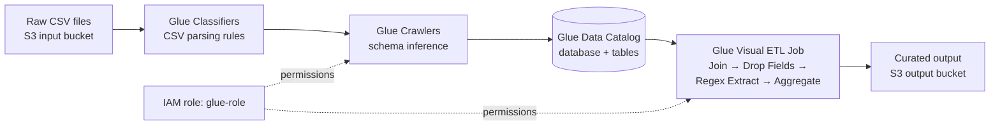
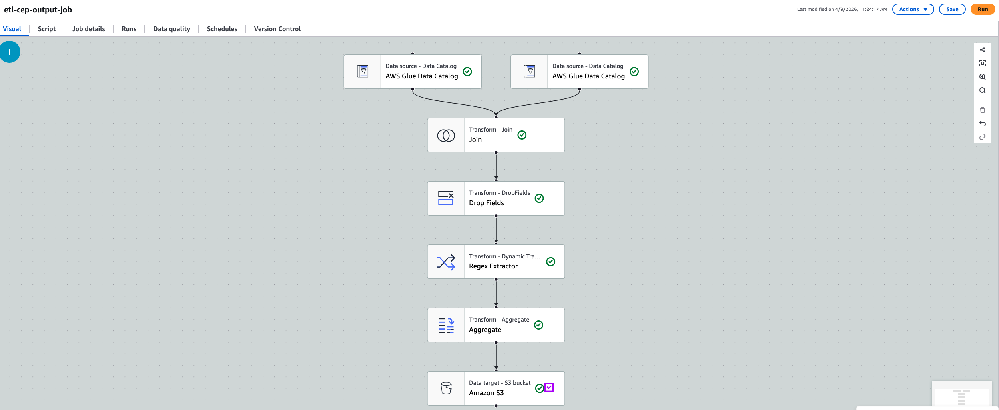
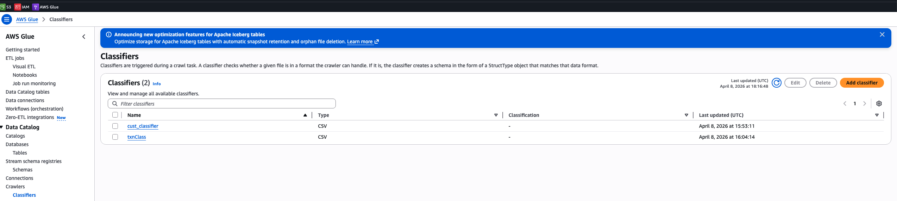
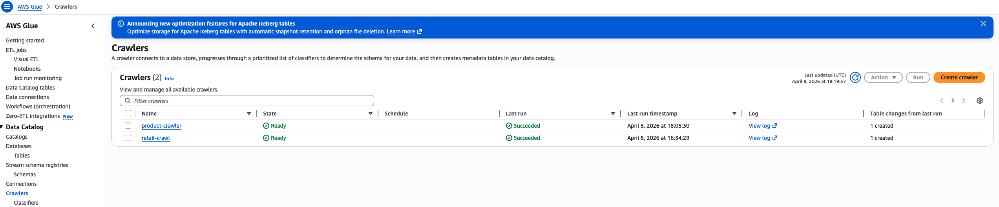
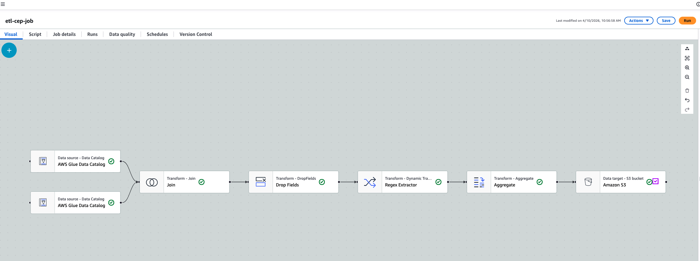
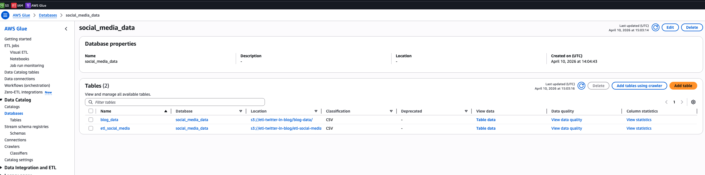
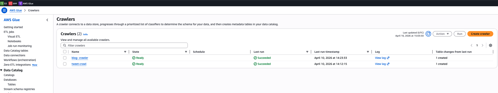

# Cloud ETL Pipelines with AWS Glue & Amazon S3


Two end-to-end **Extract → Transform → Load** pipelines built on AWS. Each one takes raw CSV files from Amazon S3, catalogs them with AWS Glue, cleans, joins and aggregates them in a Glue Visual ETL job, and writes analysis-ready output back to S3.

| # | Project | Business question | Output |
|---|---------|-------------------|--------|
| 1 | [**ABC Retail: Sales Data Management**](#project-1--abc-retail-sales-data-management) | How do average sales differ by product category and shipping method? | 16-row summary of avg. sales by category × ship mode |
| 2 | [**Social Media Data Integration**](#project-2--social-media-data-integration-twitter--blogs) | How can Twitter and blog activity be combined into one user-level view? | User-level summary of tweet count and first activity |

---

## Why I built these

As a data analyst I spend much of my time on data that isn't ready to analyse yet. It arrives in separate files, in mixed formats, and with values such as `$1,234.56` stored as text. These projects show that I can:

- **Own the data preparation step** instead of relying on manual spreadsheet merges.
- **Build repeatable pipelines.** When the source files in S3 are updated, the same job reruns and produces fresh output.
- **Turn row-level records into business insight** through joins, cleansing and aggregation.
- **Work securely in the cloud** with separate raw and curated storage and least-privilege IAM roles.

---

## Architecture (shared by both projects)



| ETL stage | What happens | AWS service |
|-----------|--------------|-------------|
| **Extract** | Raw CSVs are stored in separate S3 folders, one per source. Classifiers and crawlers infer the schema and register tables in the Data Catalog. | S3, Glue Classifiers, Glue Crawlers, Glue Data Catalog |
| **Transform** | Inner join on a shared key, drop the duplicate key column, extract numeric values with regex, and group and aggregate. | Glue Visual ETL (Apache Spark) |
| **Load** | The result is written to a separate S3 output bucket, so raw and curated data are never mixed. | S3 |

---

## Project 1: ABC Retail Sales Data Management

### Overview
ABC Retail kept **order transactions** (order ID, ship mode, product ID, sales amount) and **product details** (product name, category) in two separate CSV files. Neither file could answer category-level questions by itself. I built a Glue pipeline that joins and cleans the two files, then summarises **average sales by product category and ship mode**.

### Pipeline details

| Step | Implementation | Why it matters |
|------|----------------|----------------|
| Storage | Input bucket with `transaction-files/` and `product-files/` folders, plus a separate output bucket | Keeps sources isolated for crawling and separates raw data from curated data |
| Catalog | Glue database `abc-retail`, two CSV classifiers (comma delimiter, `"` quote), two crawlers | Turns raw files into queryable tables with the correct column structure |
| Security | IAM role `glue-role` | Gives Glue scoped read/write access to S3 and the catalog |
| **Join** | Inner join, `Product ID` = `ProductID` | Adds product category to every transaction |
| **Drop Fields** | Removed the duplicate `ProductID` column | Clean schema with no redundant keys |
| **Regex Extractor** | Pulled the numeric value out of `Sales` (e.g. `$1,234` → `1234`) into `NetSales` | Converts currency text into a number that can be aggregated |
| **Aggregate** | Group by `Product Category` and `Ship Mode`, AVG(`Sales`) | Turns order rows into a business-level summary |
| **Load** | Written to S3 as Parquet first, then switched to CSV | CSV can be read directly by reviewers and BI tools |

<p align="center">
  
  <br/><em>Glue Visual ETL job: two catalog sources → Join → Drop Fields → Regex Extractor → Aggregate → S3</em>
</p>

### Results
Average sales (USD) by category and ship mode. Full output: [`avg_sales_by_category_shipmode.csv`](01-retail-sales-etl/results/avg_sales_by_category_shipmode.csv)

| Product Category | Standard Class | Same Day | First Class | Second Class |
|------------------|---------------:|---------:|------------:|-------------:|
| Electronic | **1,697.34** | 1,421.03 | 1,472.43 | 1,283.80 |
| Home & Furniture | **1,695.19** | 1,487.45 | 1,474.78 | 1,276.66 |
| Fashion | **1,692.61** | 1,493.06 | 1,461.82 | 1,274.70 |
| Auto & Accessories | **1,688.18** | 1,445.36 | 1,433.54 | 1,284.60 |

### Key insights
- **Standard Class has the highest average order value in every category**, about **$1,690**. That is roughly **32% higher than Second Class** (about $1,280), which is the lowest everywhere.
- **Ship mode matters more than category.** Within a ship mode, the four categories are less than $75 apart. Across ship modes, the gap is about $400.
- **Business takeaway:** higher-value baskets go with standard shipping. This is worth investigating for shipping-threshold promotions, or to check whether Second Class customers are being under-served.

### Challenges solved
- **Classifier design:** values like `Auto & Accessories` contain `&`. I confirmed that `&` is part of the data, not a delimiter, so a comma-delimited CSV classifier was correct.
- **Parquet vs. CSV:** S3 Select returned *"method not allowed"* on the Parquet output. I switched the target format to CSV so the file could be read directly. (Athena would be the production option for querying Parquet.)
- **Schema propagation:** the new `NetSales` column only appeared in downstream nodes after the Regex Extractor preview had fully loaded. Learning this saved repeated debugging.

<details>
<summary><b>More screenshots: S3 input layout, classifiers, crawlers</b></summary>
<br/>

**S3 input bucket with separate source folders**


**CSV classifiers**


**Crawlers that ran successfully and created catalog tables**


</details>

---

## Project 2: Social Media Data Integration (Twitter + Blogs)

### Overview
User activity was spread across two sources: a **Twitter dataset** and a **blog dataset**. The goal was to combine them into one trusted, user-level view, so that cross-platform engagement can be analysed. This view is also the base for later work such as sentiment analysis.

### Pipeline details

| Step | Implementation | Why it matters |
|------|----------------|----------------|
| Storage | Input bucket with one folder per source, plus a separate output bucket | Organised, isolated sources |
| Catalog | Glue database `social_media_data`; classifiers `twitter_data` and `blog_data`; crawlers `tweet-crawl` and `blog-crawler` | Creates the tables `etl_social_media` and `blog_data` |
| Security | IAM role `glue-role` | Secure, scoped access for Glue |
| **Join** | Inner join on `user id` | Keeps only users present in both sources, which protects data integrity |
| **Drop Fields** | Removed the duplicate `user id` column | Clean, non-redundant schema |
| **Transform** | Dynamic transform / regex step | Normalises fields before aggregation |
| **Aggregate** | Group by `user id`: COUNT(`tweet id`), MIN(`timestamp`) | Measures each user's activity and when they were first active |
| **Load** | CSV written to the S3 output bucket | Ready for reporting or further modelling |

<p align="center">
  
  <br/><em>Glue Visual ETL job <code>etl-cep-job</code>: Twitter + Blog sources → Join → Drop Fields → Regex Extractor → Aggregate → S3</em>
</p>

### Results
Output: [`user_activity_summary.csv`](02-social-media-integration/results/user_activity_summary.csv)

| user id | count(tweet id) | min(timestamp) |
|---------|----------------:|----------------|
| 123 | 1 | 2024-05-20T08:00:00 |

The inner join kept only users who appear in **both** Twitter and the blogs. In this sample data that was one user. This is how the integrity check is meant to behave: records that can't be matched across platforms are left out of the integrated view.

<details>
<summary><b>More screenshots: Data Catalog, crawlers, S3 output</b></summary>
<br/>

**Glue database `social_media_data` with both cataloged tables**


**Crawlers that ran successfully**


**Curated output written to S3**


</details>

### Next steps
- Add **sentiment scoring** of tweet and blog text, for example with Amazon Comprehend, as an extra transform.
- Use a **left join** as well, to measure how many users are active on only one platform.

---

## Tech stack

| Category | Tools |
|----------|-------|
| Cloud platform | Amazon Web Services (us-east-1) |
| Storage / data lake | Amazon S3 (separate raw and curated buckets) |
| ETL engine | AWS Glue Visual ETL (serverless Apache Spark) |
| Metadata & schema | AWS Glue Data Catalog, Classifiers, Crawlers |
| Security | AWS IAM (service role for Glue) |
| Transformations | Inner Join, Drop Fields, Regex Extractor, Aggregate (AVG, COUNT, MIN) |
| File formats | CSV, Apache Parquet (Snappy) |
| Documentation | Written project reports (`.docx`) |

## Skills demonstrated
`ETL design` · `Data integration` · `Data cleansing` · `Schema inference` · `Data cataloging` · `Aggregation & summarisation` · `Cloud storage architecture` · `IAM & access control` · `Columnar vs. row formats` · `Troubleshooting` · `Turning results into business insight`

---

## Repository structure

```
.
├── README.md
├── 01-retail-sales-etl/
│   ├── images/                                   # Pipeline & console screenshots
│   ├── report/Retail_Data_Management_Report.docx # Full written report
│   └── results/avg_sales_by_category_shipmode.csv
└── 02-social-media-integration/
    ├── images/
    ├── report/Social_Media_Data_Integration_Report.docx
    └── results/user_activity_summary.csv
```

Full reports: [Project 1, ABC Retail](01-retail-sales-etl/report/Retail_Data_Management_Report.docx) · [Project 2, Social Media](02-social-media-integration/report/Social_Media_Data_Integration_Report.docx)

---

## Author

**Lea Iradukunda**, Data Analyst
**LinkedIn**, [Data Analyst](https://www.linkedin.com/in/lea-iradukunda/)

*Open to data analyst opportunities. Feel free to connect.*
<!-- Add your LinkedIn / email links here -->
